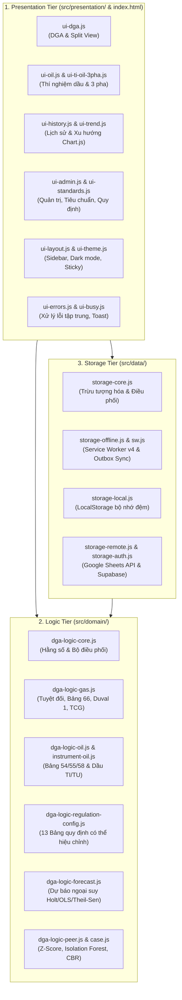

# Tổng quan Dự án & Danh mục Toàn bộ Tính năng Ứng dụng DGA (Dầu cách điện)

> **Tài liệu tham chiếu toàn diện về Dự án DGA Web App**  
> Căn cứ tiêu chuẩn: **Quyết định 1901/QĐ-EVNNPT** & **IEC 60599:2022**  
> Kiến trúc hệ thống: **Three-Tier Architecture (Presentation – Logic – Storage)** & **Offline-First PWA**

---

## 1. Giới thiệu Dự án & Mục tiêu

Ứng dụng **DGA Web App** (Đánh giá Dầu cách điện & Phân tích khí hòa tan) là hệ thống phần mềm chuyên dụng hỗ trợ các kỹ sư thí nghiệm điện, cán bộ quản lý kỹ thuật của Tổng công ty Truyền tải điện Quốc gia (EVNNPT) thực hiện:
- Phân tích và đánh giá tình trạng cách điện của các thiết bị điện cao áp ngâm dầu: **Máy biến áp (MBA) & Kháng điện, Máy biến dòng điện (TI), Máy biến điện áp (TU), Sứ xuyên (Bushing), và Bộ đổi nấc có tải (OLTC)**.
- Tự động hóa công tác nhập liệu từ các Biên bản thí nghiệm (BBTN) dạng PDF và ảnh chụp tấm nhãn thiết bị (Nameplate OCR).
- Giám sát tình trạng vận hành, phát hiện sớm các sự cố tiềm ẩn (nhiệt, điện, phóng điện cục bộ), dự báo xu hướng sinh khí và hỗ trợ ra quyết định bảo dưỡng chính xác.
- Vận hành tin cậy, linh hoạt trong mọi điều kiện mạng (online/offline) và đồng bộ dữ liệu trên cả nền tảng máy tính (Web) và thiết bị di động (Mobile).

---

## 2. Kiến trúc Hệ thống (Three-Tier Architecture)

Hệ thống được thiết kế theo mô hình **3 tầng phân tách độc lập (Separation of Concerns)**, giúp mã nguồn dễ bảo trì, mở rộng và kiểm thử tự động:

1. **Presentation Tier (Tầng hiển thị):**
   - Đặt trong thư mục `src/presentation/` (`components/`, `tabs/`), chia thành 18 module chuyên trách quản lý từng tab và tương tác người dùng.
   - Hoàn toàn không chứa công thức tính toán ngưỡng hoặc chẩn đoán sự cố.
2. **Logic Tier (Tầng nghiệp vụ DGA):**
   - Đặt trong thư mục `src/domain/`, là mã JavaScript thuần (vanilla JS), phi trạng thái (stateless), 100% không phụ thuộc DOM hoặc trình duyệt.
   - Được biên dịch tự động thành `mobile/dga-logic.js` cho bản di động, đảm bảo Web và Mobile cho ra kết quả chẩn đoán giống hệt nhau với cùng một bộ số liệu.
3. **Storage Tier (Tầng lưu trữ dữ liệu):**
   - Đặt trong thư mục `src/data/drivers/`, cung cấp API thống nhất qua `src/data/storage.js` hỗ trợ 3 backend: **Google Sheets (qua Apps Script)**, **Supabase (PostgreSQL)**, và **LocalStorage (Offline/Demo)**.
   - Tích hợp mô hình hàng đợi ngoại tuyến **Outbox Sync Pattern** tự động đẩy dữ liệu lên máy chủ khi có mạng trở lại.

---

## 3. Toàn bộ Tính năng theo từng Tab Chức năng

### 3.1. Tab "Khí hòa tan" (DGA) — Phân tích & Đánh giá Khí hòa tan

Đây là tab tác nghiệp trung tâm của ứng dụng:

- **Nhập liệu thông minh & Gợi ý tự động:**
  - *Trạm & Thiết bị:* Hộp nhập liệu lai (Combobox) cho phép vừa gõ tìm kiếm nhanh, vừa chọn từ danh sách đã có, hoặc nhập mới trực tiếp.
  - *Phân loại thiết bị:* Hỗ trợ 5 nhóm: TI, TU, MBA/Kháng dầu, Sứ xuyên (Bushing), Khác.
  - *MBA có ngăn OLTC:* Hộp kiểm "Ngăn OLTC (thông dầu/khí với thùng chính)" để chọn bảng đối chiếu Annex A.2.4 Table A.2.
  - *Nhà sản xuất:* Tùy chọn áp dụng tiêu chuẩn riêng của nhà sản xuất (nếu đã cấu hình).
  - *Tự động gợi ý lần đo:* Hệ thống tự tra cứu lịch sử đo của thiết bị (khớp đúng Trạm + Thiết bị + Pha) để tự động tăng số lần đo kế tiếp.
  - *7 khí hòa tan chính:* H2, CH4, C2H6, C2H4, C2H2, CO, CO2 (chấp nhận số thập phân hoặc giá trị "KPH" — Không phát hiện, tự quy về 0 ppm).
  - *Khí bổ sung N2, O2:* Dùng cho tỷ lệ Điều 54 (CO2/CO, O2/N2) và Tổng hàm lượng khí hòa tan (Bảng 63, Điều 54).
  - *Thông số kỹ thuật thiết bị:* Kiểu máy, năm sản xuất, năm vận hành, điện áp định mức, số chế tạo, loại dầu, kết cấu cách điện, hiện trạng vận hành.
  - *Thông tin thí nghiệm bổ sung:* Ngày thí nghiệm, lý do thí nghiệm, nhiệt độ, độ ẩm môi trường.

- **Khung hiển thị Biên bản đối chiếu song song (Split View Preview Pane):**
  - **Tự động mở khi kéo-thả hoặc chọn PDF:** Ngay khi nạp file PDF BBTN, giao diện tự động chia làm 2 cột: Cột trái là form số liệu, Cột phải là khung tài liệu PDF gốc (`iframe`).
  - **Bám dính khi cuộn (Sticky):** Khung xem trước PDF cố định trên màn hình máy tính, giúp người dùng vừa cuộn form nhập liệu vừa dễ dàng đối chiếu mắt từng giá trị (H2, CH4, C2H2, v.v.) với văn bản gốc trước khi lưu.
  - **Tiện ích trên thanh công cụ xem trước:**
    - Tên file tài liệu và huy hiệu trạng thái (`Đã trích xuất số liệu` / `Đang đọc BBTN...` / `BBTN đã lưu`).
    - Nút **"Mở tab mới"** để xem tài liệu ở chế độ toàn màn hình trình duyệt.
    - Nút **"✕ Ẩn"** và nút **"Hiện BBTN đối chiếu"** để đóng/mở lại khung bất kỳ lúc nào.
  - **Tự động nạp lại khi sửa lần đo:** Mở lại lần đo cũ đã lưu có đính kèm PDF sẽ tự động hiển thị lại văn bản gốc vào khung đối chiếu.
  - **Quản lý bộ nhớ an toàn:** Tự động giải phóng `URL.revokeObjectURL()` khi bấm "Xóa form" hoặc "Hủy sửa", không gây rò rỉ bộ nhớ trình duyệt.

- **Động cơ phân tích & Đánh giá DGA đa phương pháp:**
  - **Đánh giá giá trị tuyệt đối từng khí:** So sánh với bảng ngưỡng QĐ1901/IEC hoặc tiêu chuẩn riêng của nhà sản xuất.
  - **Tổng lượng khí cháy (TCG):** Tự động tính tổng $\text{H}_2 + \text{CH}_4 + \text{C}_2\text{H}_6 + \text{C}_2\text{H}_4 + \text{C}_2\text{H}_2 + \text{CO}$.
  - **Chẩn đoán sự cố bằng 3 phương pháp độc lập:**
    1. *Bảng 66 QĐ1901 / Table 1 IEC 60599:2022:* Sử dụng 3 tỷ số khí $\text{C}_2\text{H}_2/\text{C}_2\text{H}_4$, $\text{CH}_4/\text{H}_2$, $\text{C}_2\text{H}_4/\text{C}_2\text{H}_6$ để xác định 6 mã sự cố (PD: Phóng điện cục bộ, D1: Phóng điện năng lượng thấp, D2: Phóng điện năng lượng cao, T1: Quá nhiệt $<300^\circ\text{C}$, T2: Quá nhiệt $300\text{--}700^\circ\text{C}$, T3: Quá nhiệt $>700^\circ\text{C}$). Ngưỡng PD tự động điều chỉnh theo loại thiết bị (Sứ xuyên: 0,07; MBA: 0,1; TI/TU: 0,2).
    2. *Table A.10 IEC 60599:2022 (Dành riêng cho Sứ xuyên):* Chẩn đoán 4 mã độc lập PD, D, T, TP; nếu không khớp mã nào thì tự động lùi về Bảng 66.
    3. *Tam giác Duval 1:* Vẽ trực quan trên Canvas HTML5 với tọa độ phần trăm %CH4, %C2H4, %C2H2 (tổng = 100%), định vị điểm chẩn đoán trong các vùng sự cố (PD, T1, T2, T3, D1, D2, DT).
  - **Tốc độ sinh khí (Rate of Gas Generation):** So sánh với lần đo liền trước theo Bảng 65 QĐ1901 (%/tháng hoặc ppm/ngày).
  - **Đánh giá Trạng thái Tổng thể:** Tổng hợp thành 3 cấp độ: **Bình thường (Xanh)**, **Cảnh báo - ALERT (Vàng cam)**, **Báo động - ALARM (Đỏ)**, kèm cờ cảnh báo đặc biệt khi **Vượt ngưỡng loại bỏ (Condemning limit)**.
  - **Khuyến cáo hành động kỹ thuật:** Đưa ra chỉ dẫn cụ thể (rút ngắn chu kỳ đo, kiểm tra tải, kiểm tra rơ le gas, dừng vận hành kiểm tra...).
  - **So sánh thống kê nâng cao (Tham khảo bổ sung):**
    - *So sánh nhóm thiết bị tương tự:* Tính toán điểm bất thường đa chiều bằng **Isolation Forest** tự dựng và Z-score thang Log1p cho từng khí so với nhóm thiết bị cùng chủng loại.
    - *Ca sự cố tương tự (Case-Based Reasoning):* Tính độ tương đồng hình học (Cosine similarity) với toàn bộ kho dữ liệu lịch sử để gợi ý tối đa 3 ca đo có biểu hiện gần nhất.

- **Xuất văn bản báo cáo chuyên nghiệp:**
  - **Xuất BBTN (.docx):** Điền toàn bộ số liệu đo và kết quả đánh giá vào mẫu Biên bản thí nghiệm chuẩn PTC3/BM.15 qua thư viện Docxtemplater chạy 100% trong trình duyệt.
  - **Xuất Báo cáo phân tích kỹ thuật (.docx):** Tự động xuất hiện khi thiết bị có bất thường (Cảnh báo/Báo động), tổng hợp đầy đủ thông số kỹ thuật, tỷ số khí, biểu đồ Duval và đề xuất xử lý.

- **Nhập hàng loạt BBTN (Batch Import):**
  - Kéo thả nhiều file PDF hoặc chọn nguyên thư mục chứa nhiều năm đo của cùng 1 thiết bị.
  - Bảng xem trước danh sách file, kiểm tra trùng lặp ngày đo, chỉnh sửa pha trực tiếp và lưu hàng loạt vào cơ sở dữ liệu.
  - Tự động đánh lại số lần đo theo trình tự thời gian tăng dần (`Sắp xếp lại Lần đo`).

---

### 3.2. Tab "Dầu cách điện" — Thí nghiệm Lý-Hóa Dầu

Đánh giá chất lượng dầu cách điện theo các điều khoản quy định của QĐ1901:

- **1. Dầu MBA chính (MBA/Kháng dầu):**
  - 3 chỉ tiêu cốt lõi: Độ ẩm dầu (ppm), Tổn hao điện môi tgδ ở 90°C (%), Điện áp chọc thủng BDV (kV) — căn cứ theo Bảng 58, 55, 54 QĐ1901.
  - Phân loại theo cấp điện áp (đến 35kV, 110-220kV, 500kV) và tình trạng dầu (dầu mới nhận, trước đóng điện, đang vận hành).
  - Tự động nhận diện cấu hình bảo vệ màng ngăn N2/màng cao su.
  - Hỗ trợ lấy mẫu chung 3 pha hoặc theo từng pha riêng biệt (A, B, C).

- **2. Dầu OLTC (Bộ đổi nấc có tải):**
  - Đánh giá Độ ẩm, tgδ 90°C, Điện áp chọc thủng theo Điều 37, Bảng 49 QĐ1901 (dầu vận hành) hoặc Bảng 58 (dầu mới).
  - Điểm lấy mẫu: Điểm cuối trung tính hoặc từng pha riêng biệt.

- **3. BBTN Dầu 3 pha TI/TU (PTC3/BM.14):**
  - **Nhập liệu đồng thời 3 pha:** Đọc file PDF mẫu PTC3/BM.14 hoặc nhập tay đồng thời cả 3 pha A, B, C trong cùng một form.
  - **Khung đối chiếu song song (Split View):** Tự động mở khung hiển thị PDF bên cạnh bảng số liệu 3 pha để kiểm tra đối chiếu.
  - **Đánh giá theo 2 tầng ngưỡng NSX:** Áp dụng tiêu chuẩn Bình thường và Loại bỏ theo nhà sản xuất (do TI/TU không có bảng mặc định trong QĐ1901).
  - **Cột đối chiếu "Trên BBTN":** Hiển thị kết luận in trên biên bản giấy bên cạnh kết luận của phần mềm và đưa ra cảnh báo nếu có sự sai lệch.
  - **Lưu trữ & Tách bản ghi tự động:** Khi bấm lưu, dữ liệu được tự động tách thành 3 bản ghi riêng biệt trong lịch sử đo để các tab Cảnh báo và Xu hướng có thể theo dõi chi tiết từng pha.
  - **Xuất BBTN dầu 3 pha (.docx):** Xuất lại file Word biên bản theo mẫu chuẩn, đã điền sẵn số liệu và kết luận tự động.

- **4. Dầu TI/TU đơn lẻ & Sứ xuyên:**
  - Nhập và đánh giá thí nghiệm dầu cho từng pha riêng lẻ của TI/TU theo tiêu chuẩn nhà sản xuất đã cấu hình.
  - Hướng dẫn rõ ràng: Sứ xuyên kín dầu không thí nghiệm dầu, hướng dẫn chuyển sang đánh giá khí DGA.

---

### 3.3. Tab "Lịch sử đo" — Tra cứu & Quản lý Nhật ký Dữ liệu

- **Bảng nhật ký đa năng:**
  - Chuyển đổi linh hoạt giữa 2 chế độ hiển thị: **Khí hòa tan (DGA)** và **Dầu cách điện** (gộp dầu MBA, OLTC, TI/TU).
  - Lọc dữ liệu tức thời theo Trạm (combobox), Thiết bị, Loại thiết bị và Cấp điện áp.
- **Minh bạch lịch sử chỉnh sửa:**
  - Lưu vết tài khoản người nhập ban đầu và người sửa cuối cùng kèm dấu thời gian.
  - Huy hiệu `✎ N lần sửa`: Bấm để xem chi tiết lịch sử sửa đổi (trường dữ liệu nào bị sửa, giá trị cũ là bao nhiêu, sửa vào thời gian nào).
  - Tô màu cảnh báo trực tiếp trên các ô số liệu đã bị chỉnh sửa so với ban đầu.
- **Tiện ích xem lại văn bản:**
  - Nút **"Xem BBTN"**: Mở lại file PDF gốc đính kèm trực tiếp trong khung đối chiếu song song hoặc mở tab mới.
  - Nút **"BBTN 3 pha"**: Mở lại toàn bộ biên bản 3 pha TI/TU để xem hoặc xuất lại Word.
- **Công cụ so sánh tốc độ sinh khí giữa 2 lần đo bất kỳ:**
  - Chọn thiết bị và 2 mốc thời gian bất kỳ (không nhất thiết phải là 2 lần đo liên tiếp), app tự tính tốc độ gia tăng từng khí và đối chiếu với ngưỡng Bảng 65 QĐ1901.

---

### 3.4. Tab "Cảnh báo" — Dashboard Giám sát Thiết bị Bất thường

- **Tự động rà soát toàn diện:** Quét lần đo gần nhất của toàn bộ thiết bị trên cả 4 nguồn dữ liệu (Khí DGA, Dầu MBA, Dầu OLTC, Dầu TI/TU).
- **Thống kê phân cấp:**
  - Đếm tổng số thiết bị theo dõi, số thiết bị bình thường, số thiết bị ở mức **Cảnh báo (ALERT)**, số thiết bị ở mức **Báo động (ALARM)**, và số thiết bị **Vượt ngưỡng loại bỏ**.
- **Danh sách chi tiết & Điều hướng nhanh:**
  - Hiển thị rõ nguyên nhân cảnh báo (khí nào vượt ngưỡng, tốc độ tăng bất thường ra sao, mã sự cố chẩn đoán là gì).
  - Nút **"Xem xu hướng"** trên từng dòng thiết bị: Tự động chuyển sang tab "Xu hướng", tự tick chọn thiết bị và các khí đang bị cảnh báo để vẽ đồ thị phân tích ngay lập tức.
- **Xuất báo cáo Excel (.xlsx):** Xuất toàn bộ danh sách thiết bị cảnh báo kèm khuyến cáo kỹ thuật ra file Excel theo đúng bộ lọc trạm đang chọn.

---

### 3.5. Tab "Xu hướng" — Phân tích Đồ thị & Dự báo Tương lai

- **Biểu đồ đa thông số tương tác (Chart.js):**
  - Vẽ diễn biến theo thời gian của 7 khí DGA chính, N2, O2, TCG, Tổng hàm lượng khí hòa tan, và các chỉ tiêu dầu cách điện trên cùng một hệ trục.
  - Mỗi loại thông số có trục tung (Y-axis) riêng phù hợp với thang đo và đơn vị.
  - Bật/tắt nhanh từng đường đồ thị bằng cách click vào chú giải (Legend).
- **Dự báo xu hướng sinh khí tương lai:**
  - Áp dụng 3 thuật toán ngoại suy tuyến tính độc lập: **Hồi quy bình phương tối thiểu (OLS)**, **Ước lượng bền vững Theil-Sen**, và **Trung bình tốc độ gần nhất**.
  - Tính đường trung bình tổng hợp của 3 thuật toán, hệ số tin cậy $R^2$, tốc độ tăng trưởng (ppm/năm).
  - Ước tính số tháng/năm thiết bị sẽ chạm ngưỡng giới hạn nếu tiếp tục duy trì tốc độ sinh khí hiện tại.
  - Tùy chỉnh khoảng thời gian dự báo từ 1 đến 30 năm.

---

### 3.6. Tab "Quy trình" — Cẩm nang & Sơ đồ Nghiệp vụ

- **7 phương pháp lấy mẫu dầu chuẩn (Điều 8 QĐ1901):**
  - Hướng dẫn chi tiết kỹ thuật lấy mẫu từ: thùng phuy, xitéc, thiết bị điện, chai thủy tinh, xilanh thủy tinh, ống đựng mẫu chuyên dụng.
  - Sơ đồ kỹ thuật minh họa (Hình 2 đến Hình 5) và thư viện ảnh thực tế hiện trường.
  - Chức năng Lightbox phóng to ảnh, đóng bằng phím `Esc` hoặc bấm ra ngoài.
- **2 Sơ đồ tư duy (Mindmap) tương tác:**
  - *Sơ đồ 1:* Quy trình đánh giá khí hòa tan DGA theo QĐ1901/IEC.
  - *Sơ đồ 2:* Cơ chế hình thành khí, 7 loại khí chỉ thị sự cố, phân loại lỗi nhiệt và điện.
  - Có các nút "Mở tất cả" / "Thu gọn tất cả" tiện lợi.
- **Căn cứ pháp lý đầy đủ:** Trích dẫn chính xác từng điều khoản, bảng số liệu của QĐ1901/QĐ-EVNNPT và IEC 60599:2022.

---

### 3.7. Tab "Hướng dẫn" & Tab "Giới thiệu"

- **Tab Hướng dẫn sử dụng tích hợp:**
  - Gồm 19 chuyên đề accordion chi tiết từ cơ bản đến nâng cao (đăng nhập, nhập liệu, đối chiếu BBTN, đọc kết quả, cấu hình, xử lý sự cố...).
  - Được biên dịch tự động từ file chuẩn `docs/huong-dan/user_manual.md` qua công cụ build, đảm bảo tính đồng bộ tuyệt đối giữa tài liệu và ứng dụng.
- **Tab Giới thiệu:**
  - Thông tin phiên bản, bản quyền, mục tiêu dự án và đầu mối hỗ trợ kỹ thuật.

---

## 4. Khu vực "Quản trị" & Tiện ích Toàn cục (Header & UI Utilities)

### 4.1. Khu vực "Quản trị" (Admin Console)

Được tích hợp tập trung trên thanh Header dành riêng cho tài khoản có quyền Quản trị viên (Admin), bao gồm 3 phân hệ con:

1. **Phân hệ Người dùng (`Quản trị > Người dùng`):**
   - Danh sách toàn bộ tài khoản trong hệ thống: Email, vai trò (Admin / User), ngày tạo, lần đăng nhập gần nhất.
   - Thêm tài khoản mới, phân quyền vai trò.
   - Khóa/mở khóa tài khoản, kích hoạt hoặc đặt lại mật khẩu cho người dùng.
   - Cơ chế tự bảo vệ: Tự động vô hiệu hóa nút xóa và hạ quyền đối với tài khoản Admin đang tự đăng nhập.

2. **Phân hệ Cấu hình (`Quản trị > Cấu hình`):**
   - **Mục "Tiêu chuẩn" (Tiêu chuẩn Nhà sản xuất):**
     - Cấu hình ngưỡng khí riêng (tuyệt đối, loại bỏ, tốc độ tăng) cho từng hãng sản xuất máy biến áp, kháng điện, sứ xuyên.
     - Cấu hình 2 tầng ngưỡng (Bình thường / Loại bỏ) cho dầu cách điện TI/TU theo từng hãng (Arteche, Trench, v.v.).
   - **Mục "Quy định" (13 Bảng ngưỡng quy chuẩn):**
     - Cho phép chỉnh sửa tham số của **13 bảng ngưỡng số học** trích từ QĐ1901 và IEC 60599 (Bảng 64, Bảng 65, Bảng 49, Bảng 54, Bảng 55, Bảng 58, Bảng 63...) trực tiếp trên giao diện khi quy chuẩn ngành có cập nhật mới mà không cần can thiệp mã nguồn.
     - Nút "Khôi phục mặc định" giúp quay lại các giá trị chuẩn ban đầu của hệ thống.

3. **Phân hệ Bản sao Supabase (`Quản trị > Bản sao Supabase`):**
   - Công cụ đồng bộ, sao lưu và di chuyển dữ liệu giữa Google Sheets và cơ sở dữ liệu Supabase.
   - Cho phép xuất file sao lưu JSON, kiểm tra tính toàn vẹn dữ liệu và phục hồi khi cần thiết.

---

### 4.2. Thanh Tiêu đề & Menu bar Toàn cầu (Header)

Thanh Header được cố định ở mép trên màn hình (Sticky Header) với tính năng tự động đo đạc chiều cao thực tế bằng `ResizeObserver`, chứa các công cụ tiện ích toàn cục:

- **Logo EVNNPT & Tên ứng dụng:** Nhận diện thương hiệu chuẩn của Tập đoàn Điện lực Việt Nam / EVNNPT.
- **Nút chuyển đổi bố cục Tab (Thanh ngang ⇄ Sidebar):**
  - Chuyển đổi linh hoạt giữa giao diện tab nằm ngang phía trên và giao diện cột điều hướng bên trái (Sidebar).
  - Ghi nhớ trạng thái ưa thích của người dùng qua `localStorage`.
- **Nút Thu gọn / Mở rộng Sidebar:**
  - Ở chế độ Sidebar, nút mũi tên ở đầu thanh cho phép thu gọn sidebar về dạng thanh icon hẹp 60px để tối đa hóa không gian làm việc cho vùng nội dung chính.
  - Mũi tên tự động xoay chiều chỉ hướng bằng CSS transform và nhớ trạng thái thu gọn.
- **Huy hiệu kết nối Lưu trữ (Storage Badge):**
  - Hiển thị chế độ lưu trữ hiện tại: `Google Sheets` (xanh), `Supabase` (xanh lục), `Local` (cam).
  - Bấm vào badge sẽ mở trực tiếp trang quản lý Google Sheet hoặc Dashboard Supabase tương ứng ở tab mới.
- **Huy hiệu Trạng thái Đồng bộ (Sync Badge):**
  - Giám sát trạng thái kết nối mạng và hàng đợi ngoại tuyến theo thời gian thực: `Đã đồng bộ` (chấm xanh), `Ngoại tuyến: N chờ gửi` (chấm cam), `Đang đồng bộ...` (chấm xoay).
- **Chuyển đổi Giao diện Sáng / Tối (Dark / Light Mode):**
  - Nút biểu tượng Mặt trời / Mặt trăng chuyển đổi tức thì giao diện sáng và tối.
  - Tự động nhận diện theme mặc định của hệ điều hành (`prefers-color-scheme`) và áp dụng sớm qua `early-layout.js` để tránh hiện tượng nháy trắng màn hình khi tải trang.
- **Menu Người dùng (Tài khoản):**
  - Hiển thị email và vai trò người dùng đang đăng nhập.
  - Các chức năng: **Đổi mật khẩu**, **Quản trị** (chỉ Admin), **Phản hồi**, **Đăng xuất**.

---

### 4.3. Tiện ích Góp ý & Phản hồi (Feedback)

- Gửi ý kiến đóng góp, báo lỗi trực tiếp từ trong ứng dụng.
- Đính kèm 1 ảnh minh họa qua 3 hình thức thuận tiện: Chọn file từ máy, Kéo thả ảnh vào khung, hoặc **Dán trực tiếp ảnh chụp màn hình bằng phím tắt `Ctrl + V`**.
- Xem lại danh sách các góp ý đã gửi, phóng to ảnh chụp qua hộp thoại Lightbox.

---

## 5. Khả năng Chạy Ngoại tuyến & Đồng bộ Tự động (Offline-First PWA)

Ứng dụng đáp ứng tiêu chuẩn Progressive Web App (PWA) với khả năng làm việc độc lập hoàn toàn khi mất mạng:

1. **Service Worker (`sw.js` — Cache v4):**
   - Đóng gói sẵn toàn bộ các tài nguyên tĩnh (HTML, CSS, JS, Fonts, Icons, thư viện nội bộ).
   - Chiến lược bộ nhớ đệm:
     - *Local Assets:* Sử dụng chiến lược **Network-First** (ưu tiên lấy file mới nhất từ mạng, nếu mất kết nối sẽ tự động nạp từ cache offline).
     - *Thư viện CDN:* Sử dụng chiến lược **Cache-First** để tăng tốc độ nạp trang tối đa.
2. **Hàng đợi Đồng bộ Ngoại tuyến (Outbox Pattern):**
   - Khi mất mạng hoặc mạng chập chờn, người dùng vẫn thực hiện nhập lần đo mới, sửa số liệu, xóa bản ghi bình thường.
   - Thao tác ghi được lưu tạm vào hàng đợi ngoại tuyến (`LS_KEYS.outbox`).
   - Ngay khi thiết bị có kết nối Internet trở lại, hệ thống tự động nhận diện và gửi tuần tự các bản ghi trong hàng đợi lên máy chủ Google Sheets/Supabase mà không cần người dùng thao tác lại.

---

## 6. Tiêu chuẩn Mã nguồn & Đảm bảo An toàn

- **Bảo mật Content Security Policy (CSP):**
  - Cấu hình thẻ `<meta http-equiv="Content-Security-Policy">` nghiêm ngặt, chặn hoàn toàn các nguồn script không rõ nguồn gốc.
  - Cho phép WebAssembly và Web Worker cục bộ cho Tesseract.js (OCR) và PDF.js mà không dùng `unsafe-eval`.
  - Directive `frame-src` cho phép nạp tài liệu blob PDF an toàn trong khung đối chiếu song song.
- **Độc lập Thư viện (Zero External Runtime Dependencies):**
  - Các thư viện xử lý tài liệu phức tạp: **Docxtemplater**, **PizZip**, **PDF.js**, **Tesseract.js** đều được lưu trữ trực tiếp trong thư mục `vendor/` nội bộ dự án, không phụ thuộc vào các máy chủ CDN nước ngoài.
- **Kiểm thử Tự động Toàn diện (Automated Testing Suite):**
  - **17 bộ kiểm thử Jest** bao quát 335 ca kiểm thử tự động (`tests/`): kiểm tra tính nhất quán lược đồ dữ liệu, thuật toán Bảng 66, Tam giác Duval, tốc độ sinh khí, xử lý KPH, thứ tự nạp script và tính hợp lệ cú pháp V8 của toàn bộ các file JavaScript.

---

## 7. Bảng Tổng hợp Danh mục File & Thành phần Hệ thống

| Phân hệ | Đường dẫn File chính | Trách nhiệm chính |
|---|---|---|
| **Khung nhìn Web** | `index.html` | Cấu trúc giao diện HTML5, SVG icons sprite, meta CSP, bố cục chia đôi |
| **Bố cục & Phong cách** | `src/presentation/styles/style-*.css` (8 file) | Hệ thống Refactoring UI tokens, CSS Grid sidebar, Split layout đối chiếu PDF, Dark mode |
| **Khởi động Giao diện** | `early-layout.js` | Áp dụng theme và bố cục sidebar sớm trước khi vẽ trang để chống giật nháy |
| **Điều phối Chính** | `app-core.js` | Khởi tạo ứng dụng, kết nối sự kiện giao diện, vòng đời ứng dụng |
| **Phân hệ Giao diện** | `src/presentation/tabs/ui-dga.js` | Điều khiển form DGA, khung đối chiếu song song Split View, đọc BBTN |
| | `src/presentation/tabs/ui-ti-oil-3pha.js` | Điều khiển form BBTN dầu 3 pha TI/TU, khung đối chiếu 3 pha |
| | `src/presentation/tabs/ui-oil.js`, `ui-oltc.js`, `ui-ti-oil.js` | Điều khiển các form thí nghiệm dầu MBA, OLTC, TI/TU đơn lẻ |
| | `src/presentation/components/ui-layout.js` | Quản lý chuyển đổi Sidebar ngang/dọc, thu gọn/mở rộng sidebar, sticky header |
| | `src/presentation/tabs/ui-history.js` | Bảng nhật ký lịch sử đo, log chỉnh sửa, so sánh tốc độ sinh khí |
| | `src/presentation/tabs/ui-trend.js` | Biểu đồ diễn biến Chart.js, dự báo xu hướng tương lai Holt/OLS |
| | `src/presentation/tabs/ui-alerts.js` | Bảng điều khiển cảnh báo thiết bị bất thường, xuất Excel |
| | `src/presentation/tabs/ui-admin.js`, `ui-standards.js` | Quản lý người dùng, tiêu chuẩn hãng sản xuất, quy định 13 bảng ngưỡng |
| | `src/presentation/components/ui-errors.js`, `ui-busy.js` | Bắt lỗi toàn cục, hiển thị Toast thông báo và chỉ báo bận |
| **Logic Nghiệp vụ** | `src/domain/dga-logic-*.js` (9 file) | Động cơ chẩn đoán DGA, ngưỡng QĐ1901/IEC, Duval 1, Isolation Forest, Bảng 54/55/58 |
| **Tầng Dữ liệu** | `src/data/drivers/storage-*.js` (5 file) | Lớp trừu tượng Google Sheets API, Supabase, LocalStorage, Outbox Sync ngoại tuyến |
| **Ngoại tuyến** | `sw.js` | Service Worker cache v4, PWA offline, bắt sự kiện fetch |
| **Xử lý Biên bản** | `src/data/io/bbtn-import.js`, `nameplate-import.js` | Đọc text PDF (PDF.js) và nhận diện ảnh scan/tấm nhãn bằng OCR (Tesseract.js) |
| | `src/data/io/bbtn-export.js`, `oil-bbtn.js` | Điền số liệu vào file mẫu Word (.docx) qua Docxtemplater |
| **Bản Di động** | `mobile/` | Phiên bản PWA tối ưu cho màn hình cảm ứng di động, dùng chung logic DGA core |
| **Tài liệu Hướng dẫn** | `docs/huong-dan/user_manual.md` | Sách hướng dẫn sử dụng chi tiết 19 mục dành cho người dùng cuối |
| **Danh mục Tính năng** | `docs/huong-dan/Features-web-app.md` | *(Tài liệu này)* Báo cáo mô tả toàn diện tính năng và kiến trúc dự án |
