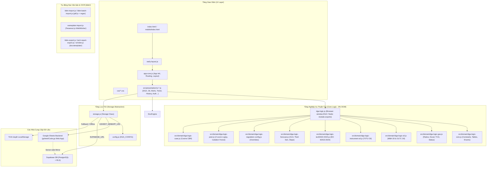

# HỒ SƠ TRI THỨC DỰ ÁN (PROJECT KNOWLEDGE BASE)
# DGA-WEBAPP — HỆ THỐNG ĐÁNH GIÁ DGA & THÍ NGHIỆM DẦU CÁCH ĐIỆN

> **Tài liệu tham chiếu toàn diện (Single Source of Truth - SSOT)** dành cho lập trình viên, kỹ sư bảo trì và các AI Agent làm việc trên codebase `dga-webapp`.
> Cập nhật lần cuối: Tháng 10/2026.

---

## MỤC LỤC
1. [Tổng quan Dự án & Triết lý Thiết kế](#1-tổng-quan-dự-án--triết-lý-thiết-kế)
2. [Cơ sở Tiêu chuẩn & Quy chuẩn Chuyên ngành](#2-cơ-sở-tiêu-chuẩn--quy-chuẩn-chuyên-ngành)
3. [Kiến trúc Hệ thống & Phân tầng Mã nguồn](#3-kiến-trúc-hệ-thống--phân-tầng-mã-nguồn)
4. [Lược đồ Dữ liệu & Lớp Lưu trữ Đa chế độ](#4-lược-đồ-dữ-liệu--lớp-lưu-trữ-đa-chế-độ)
5. [Giải thuật & Logic Nghiệp vụ Cốt lõi](#5-giải-thuật--logic-nghiệp-vụ-cốt-lõi)
6. [Tự động hóa Biên bản, Báo cáo & Trích xuất OCR/PDF](#6-tự-động-hóa-biên-bản-báo-cáo--trích-xuất-ocrpdf)
7. [Bảo mật & Gia cố An toàn Thông tin](#7-bảo-mật--gia-cố-an-toàn-thông-tin)
8. [Quy trình Phát triển, Kiểm thử & Vận hành](#8-quy-trình-phát-triển-kiểm-thử--vận-hành)
9. [Bất biến Hệ thống, Điểm Đặc thù & Cạm bẫy (Gotchas)](#9-bất-biến-hệ-thống-điểm-đặc-thù--cạm-bẫy-gotchas)

---

## 1. Tổng quan Dự án & Triết lý Thiết kế

### 1.1. Mục tiêu Nghiệp vụ
`dga-webapp` là hệ thống phần mềm chuyên dụng hỗ trợ kỹ sư thí nghiệm điện và chuyên viên quản lý kỹ thuật trạm biến áp (thuộc EVNNPT, các Công ty Truyền tải điện PTC1, PTC2, PTC3, PTC4 và các đơn vị điện lực) thực hiện:
- Đánh giá phân tích hàm lượng khí hòa tan (**Dissolved Gas Analysis - DGA**) trong dầu cách điện.
- Đánh giá các chỉ tiêu hóa lý, điện môi của **dầu cách điện** (Độ ẩm, Điện áp chọc thủng BDV, Tổn hao điện môi tgδ ở 90°C hoặc 20°C).
- Chẩn đoán dạng sự cố phát sinh bên trong thiết bị điện lực cao áp và siêu cao áp:
  - **MBA (Máy biến áp lực) & Kháng điện dầu** (Shunt Reactors).
  - **TI (Biến dòng điện - CT)**.
  - **TU (Biến điện áp - VT)**.
  - **Sứ xuyên (Condenser Bushings)**.
- Theo dõi xu hướng suy giảm cách điện, phát hiện bất thường bằng mô hình thống kê / học máy (z-score log1p, Isolation Forest), tìm kiếm ca tương tự lịch sử (CBR).
- Tự động hóa trích xuất dữ liệu từ Biên bản thí nghiệm (PDF) hoặc ảnh chụp biển nhãn máy (OCR), xuất Biên bản thí nghiệm chuẩn PTC3/BM.15 và Báo cáo phân tích kỹ thuật sự cố dạng file Microsoft Word (.docx).

### 1.2. Triết lý Thiết kế (Design Principles)
- **Zero-Build, Pure Client-Side Runtime:** Ứng dụng chạy trực tiếp từ `index.html` (hoặc `mobile/index.html`) trên mọi trình duyệt hiện đại (Chrome, Edge, Firefox, Safari) mà không qua bất kỳ bước biên dịch hay đóng gói (không cần Webpack/Vite/Babel khi chạy ứng dụng).
- **Offline-First & Độc lập Tự chủ:** Có thể hoạt động hoàn toàn ngoại tuyến chỉ bằng cách mở file `index.html` (chế độ lưu trữ `localStorage`), phục vụ tốt cho kỹ sư thao tác tại hiện trường trạm biến áp khi không có Internet.
- **Tách biệt Triệt để giữa Domain Logic và Giao diện (Separation of Concerns):** Toàn bộ công thức toán học và logic đánh giá nằm trong thư mục `logic/`, thuần túy tính toán, 0% DOM manipulation. Module logic có thể nạp độc lập trên cả Node.js (phục vụ unit test bằng Jest) lẫn trình duyệt.
- **Trừu tượng hóa Lưu trữ 3 Tầng (Tri-modal Storage):** Ứng dụng hỗ trợ liền mạch 3 backend lưu trữ (Google Sheets qua Apps Script, Supabase qua PostgreSQL REST API, và LocalStorage trình duyệt) mà UI không cần nhận biết backend bên dưới là gì.

---

## 2. Cơ sở Tiêu chuẩn & Quy chuẩn Chuyên ngành

Ứng dụng tuân thủ nghiêm ngặt các quy định kỹ thuật hiện hành của Tập đoàn Điện lực Việt Nam / Tổng công ty Truyền tải điện Quốc gia và các tiêu chuẩn Ủy ban Kỹ thuật Điện Quốc tế (IEC).

```
                      ┌────────────────────────────────────────┐
                      │    LỰA CHỌN TIÊU CHUẨN ÁP DỤNG         │
                      └──────────────────┬─────────────────────┘
                                         │
                 ┌───────────────────────┴───────────────────────┐
                 ▼                                               ▼
     Thiết bị CÓ gán NSX                             Thiết bị KHÔNG gán NSX
  & NSX đã cấu hình đủ ngưỡng?                       hoặc NSX chưa đủ ngưỡng?
                 │                                               │
        ┌────────┴────────┐                                      │
       CÓ                KHÔNG                                   │
        │                 │                                      │
        ▼                 └──────────────────┐                   │
┌────────────────────────┐                   ▼                   ▼
│ ÁP DỤNG TIÊU CHUẨN NSX │        ┌─────────────────────────────────────┐
│ (Normal / Reject Tier) │        │  ÁP DỤNG TIÊU CHUẨN CHẶT HƠN (MIN): │
└────────────────────────┘        │  min(QĐ 1901/EVNNPT, IEC 60599:2022)│
                                  └─────────────────────────────────────┘
```

### 2.1. Quyết định số 1901/QĐ-EVNNPT (EVNNPT Technical Regulation)
Quy định kỹ thuật về vận hành, bảo dưỡng và thí nghiệm thiết bị trạm biến áp của EVNNPT:
- **Bảng 12 (Điều 10) — Khí hòa tan TI/TU kiểu kín:** Ngưỡng giá trị cực đại cho phép (ppm):
  $$\text{H}_2: 300, \quad \text{CH}_4: 30, \quad \text{C}_2\text{H}_6: 50, \quad \text{C}_2\text{H}_4: 10, \quad \text{C}_2\text{H}_2: 2, \quad \text{CO}: 300, \quad \text{CO}_2: 900$$
- **Bảng 64 (Điều 54) — Khí hòa tan điển hình MBA/Kháng dầu:** Ngưỡng sàng lọc 90% (ppm):
  $$\text{H}_2: 150, \quad \text{CH}_4: 130, \quad \text{C}_2\text{H}_6: 90, \quad \text{C}_2\text{H}_4: 280, \quad \text{C}_2\text{H}_2: 20, \quad \text{CO}: 600, \quad \text{CO}_2: 14000$$
- **Bảng 65 (Điều 54) — Tốc độ sinh khí điển hình MBA/Kháng:** Khoảng giá trị tốc độ gia tăng hàng năm (ppm/năm):
  - $\text{H}_2$: $[35, 132]$
  - $\text{CH}_4$: $[10, 120]$
  - $\text{C}_2\text{H}_6$: $[5, 90]$
  - $\text{C}_2\text{H}_4$: $[32, 146]$
  - $\text{C}_2\text{H}_2$: $[0, 4]$
  - $\text{CO}$: $[260, 1060]$
  - $\text{CO}_2$: $[1700, 10000]$
- **Bảng 66 (Điều 54) — Chẩn đoán hư hỏng theo 3 tỷ số khí:** Tương đương IEC 60599 Table 1.
- **Bảng 63 (Điều 54) — Tổng hàm lượng khí hòa tan (TDGC - Total Dissolved Gas Content):**
  - Cấp $110 - 220\text{ kV}$: Ngưỡng cực đại $\le 1.0\%$ (thể tích).
  - Cấp $500\text{ kV}$: Ngưỡng cực đại $\le 0.5\%$ (thể tích).
  *(Chỉ bắt buộc áp dụng với dầu mới đưa vào vận hành hoặc sau lọc/thay dầu).*
- **Điều 54 — Tỷ lệ bổ sung:**
  - $\text{CO}_2/\text{CO} < 3$: Thoái hóa cách điện giấy xenlulo nghiêm trọng do tăng nhiệt cục bộ.
  - $\text{CO}_2/\text{CO} > 10$: Lão hóa tự nhiên của cách điện giấy ở nhiệt độ thấp.
  - $\text{O}_2/\text{N}_2 < 0.3$: Thiết bị kín có hiện tượng oxy hóa tiêu thụ dưỡng khí.
- **Bảng 54, 55, 58 (Điều 46, 47, 50) — Thí nghiệm dầu MBA:**
  - *Điện áp chọc thủng BDV (kV):* Phân theo cấp điện áp ($<15\text{kV}$, $15-35\text{kV}$, $>35-<110\text{kV}$, $110\text{kV}$, $220\text{kV}$, $500\text{kV}$) và trạng thái dầu (mới / đang vận hành).
  - *Tổn hao điện môi $\text{tg}\delta$ ở $90^\circ\text{C}$ (%):* Giới hạn cho phép theo cấp điện áp.
  - *Hàm lượng nước / Độ ẩm (ppm):* Phân biệt giữa thiết bị có màng ngăn/đệm nitơ và loại thoáng khí tự do.
- **Bảng 49 (Điều 37) — Dầu bộ đổi nấc có tải (OLTC):** Ngưỡng độ ẩm, BDV và tgδ90 cho ngăn dầu OLTC đang vận hành.

### 2.2. IEC 60599:2022
Tiêu chuẩn quốc tế hướng dẫn diễn giải kết quả phân tích khí hòa tan trong thiết bị điện ngâm dầu:
- **Annex A.2.4 (Table A.2) — MBA lực:** Khoảng nồng độ khí 90% điển hình. Đặc biệt phân biệt $\text{C}_2\text{H}_2$:
  - Không có OLTC (hoặc OLTC không thông thùng chính): $\text{C}_2\text{H}_2 \le 20\text{ ppm}$.
  - OLTC có thông dầu/khí với thùng chính: $\text{C}_2\text{H}_2 \le 280\text{ ppm}$.
- **Annex A.4.4 (Table A.7 & A.8) — TI/TU:**
  - Table A.8: Giá trị tối đa cho phép của thiết bị đo lường kiểu kín (trùng Bảng 12 QĐ1901).
  - Table A.7: Giá trị điển hình 90% phân định riêng cho CT và VT.
- **Annex A.5.4 (Table A.11) — Sứ xuyên (Condenser Bushing):**
  Ngưỡng khí 90% điển hình cho sứ xuyên (do QĐ1901 chưa có bảng riêng):
  $$\text{H}_2: 392, \quad \text{CH}_4: 216, \quad \text{C}_2\text{H}_6: 121, \quad \text{C}_2\text{H}_4: 70, \quad \text{C}_2\text{H}_2: 5, \quad \text{CO}: 927, \quad \text{CO}_2: 11578$$
- **Annex A.5.3 (Table A.10) — Bảng chẩn đoán đơn giản hóa cho Sứ xuyên:** 4 mã sự cố độc lập (PD, D, T, TP). Nếu không khớp mã nào thì fallback về Table 1.
- **Annex B (Figure B.3) — Tam giác Duval 1:** Phân loại dựa trên tỷ lệ % 3 khí $(\%CH_4, \%C_2H_4, \%C_2H_2)$ quy đổi về tổng 100%.

### 2.3. IEC 60422:2024 (Edition 5)
Tiêu chuẩn hướng dẫn giám sát và bảo dưỡng dầu khoáng cách điện:
- **Table 5 (MBA và Kháng điện):** Phân loại thành 3 Hạng mục điện áp (Categories):
  - Category A: $U_m > 170\text{ kV}$
  - Category B: $72.5\text{ kV} < U_m \le 170\text{ kV}$ (bao gồm lưới 110kV)
  - Category C: $U_m \le 72.5\text{ kV}$
  Đánh giá 3 chỉ tiêu (Độ ẩm, BDV, tgδ ở 90°C) theo 3 trạng thái: **Tốt (Good)**, **Cần theo dõi (Fair)**, **Kém (Poor)**.
- **Table 7 (Biến dòng TI và Biến điện áp TU):**
  - Category D: $U_m > 170\text{ kV}$
  - Category E: $U_m \le 170\text{ kV}$
  *(Lưu ý: Chỉ tiêu BDV cho TI/TU được hệ thống suy diễn Category D≈A, E≈B theo khuyến nghị chuyên gia do Table 7 dẫn chiếu về Table ).*

### 2.4. Tiêu chuẩn riêng của Nhà sản xuất (Manufacturer Standards)
Hệ thống hỗ trợ cấu hình tiêu chuẩn riêng theo từng nhà sản xuất:
- **Cơ chế 2 tầng ngưỡng:**
  - *Tầng 1 (Normal / Warning Limit):* Vượt qua thì chuyển trạng thái "Cảnh báo".
  - *Tầng 2 (Condemning / Reject Limit):* Vượt qua thì chuyển trạng thái "Không đạt / ⚠ Vượt ngưỡng loại bỏ".
- **Hỗ trợ đặc thù nhà sản xuất:** Ví dụ hãng **Arteche** quy định tổn hao điện môi đo ở $20^\circ\text{C}$ ($\text{tg}\delta_{20}$) thay vì $90^\circ\text{C}$; và thiết bị U.H.V ($U_m \ge 500\text{ kV}$) có ngưỡng loại bỏ $\text{tg}\delta_{20}$ nghiêm ngặt hơn ($1.5\%$ so với mức thông thường $3.0\%$).

---

## 3. Kiến trúc Hệ thống & Phân tầng Mã nguồn

Codebase tuân thủ mô hình Module tách biệt rõ ràng theo miền nghiệp vụ, không sử dụng framework nặng nề, bảo đảm tốc độ nạp trang tức thì.

### 3.1. Sơ đồ Kiến trúc Tổng thể



### 3.2. Cấu trúc Thư mục Chi tiết
```
dga-webapp/
├── index.html                 # Trang SPA chính trên Desktop/Tablet
├── css/                       # Quy tắc CSS giao diện chính, tách theo tab/khu vực
├── early-layout.js            # Script chạy tức thì trước khi render DOM để chống nhảy layout
├── app-core.js                # Khởi động ứng dụng, tab switcher, nạp dữ liệu ban đầu
├── config.js                  # Điền URL Google Apps Script hoặc Supabase credentials
├── storage.js                 # Lớp trừu tượng hóa truy cập dữ liệu (Storage layer)
├── dga-logic.js               # Điểm kết nối (Assembler) gom 9 file logic thành window.DGA
├── types.d.ts                 # Định nghĩa Type tĩnh phục vụ typecheck qua JSDoc
├── tsconfig.json              # Cấu hình TypeScript kiểm tra checkJs
├── package.json               # Khai báo test Jest, devDependencies và maintenance scripts
│
├── logic/                     # TẦNG NGHIỆP VỤ (0% DOM, chạy được cả Browser lẫn Node.js)
│   ├── dga-logic-core.js              # Bảng ngưỡng số học gốc, Enum loại thiết bị, pha, citations
│   ├── dga-logic-gas.js               # Đánh giá 7 khí, Duval 1, Tỷ số khí Bảng 66/A.10, TCG, Khuyến cáo
│   ├── dga-logic-oil.js               # Đánh giá dầu MBA và dầu bộ đổi nấc OLTC
│   ├── dga-logic-instrument-oil.js    # Đánh giá dầu TI/TU theo tiêu chuẩn NSX (Arteche tgδ20)
│   ├── dga-logic-iec60422-2024.js     # Đánh giá độc lập tham khảo theo IEC 60422:2024 Bảng 5 & 7
│   ├── dga-logic-forecast.js          # Dự báo chuỗi thời gian: OLS, Theil-Sen, Consecutive Average
│   ├── dga-logic-regulation-config.js # Quản trị ghi đè động 15 bảng quy định kỹ thuật
│   ├── dga-logic-peer.js              # So sánh nhóm thiết bị tương tự: Z-score log1p & Isolation Forest
│   └── dga-logic-case.js              # Ca sự cố tương tự lịch sử: Cosine similarity log1p
│
├── ui/                        # TẦNG ĐIỀU KHIỂN GIAO DIỆN (UI CONTROLLERS)
│   ├── ui-errors.js           # Xử lý lỗi toàn cục, popup Toast thông báo
│   ├── ui-theme.js            # Xử lý chế độ sáng/tối (Dark/Light mode)
│   ├── ui-busy.js             # Quản lý hiệu ứng loading spinner / bánh răng xoay
│   ├── ui-auth.js             # Đăng ký, đăng nhập email/mật khẩu, Google Identity GIS
│   ├── ui-dga.js              # Điều khiển tab DGA, vẽ SVG Tam giác Duval, hiển thị khuyến cáo
│   ├── ui-oil.js              # Điều khiển tab Dầu MBA
│   ├── ui-oltc.js             # Điều khiển tab Dầu OLTC
│   ├── ui-ti-oil.js           # Điều khiển tab Dầu TI/TU 1 pha
│   ├── ui-ti-oil-3pha.js      # Điều khiển tab Dầu TI/TU 3 pha tích hợp
│   ├── ui-history.js          # Bảng nhật ký lịch sử đo, so sánh tốc độ tăng khí giữa 2 lần đo bất kỳ
│   ├── ui-alerts.js           # Bảng theo dõi tình trạng cảnh báo thiết bị (ALERT/ALARM), xuất Excel
│   ├── ui-trend.js            # Vẽ biểu đồ Chart.js đa trục tung, bảng ngoại suy dự báo 30 năm
│   ├── ui-standards.js        # Cấu hình tiêu chuẩn riêng theo hãng sản xuất
│   ├── ui-regulation-config.js# Giao diện hiệu chỉnh 15 bảng quy định kỹ thuật
│   ├── ui-admin.js            # Quản trị tài khoản người dùng, kích hoạt đồng bộ Supabase mirror
│   ├── ui-feedback.js         # Gửi và hiển thị phản hồi người dùng kèm dán ảnh màn hình
│   └── ui-guides.js           # Điều khiển hiển thị tài liệu hướng dẫn sử dụng dạng accordion
│
├── bbtn/                      # TỰ ĐỘNG HÓA BIÊN BẢN & XỬ LÝ TÀI LIỆU
│   ├── bbtn-import.js         # Trích xuất dữ liệu từ file PDF BBTN (pdf.js + regex + OCR fallback)
│   ├── bbtn-batch-import.js   # Nhập hàng loạt nhiều file PDF cùng lúc để backfill dữ liệu
│   ├── nameplate-import.js    # Đọc biển nhãn thiết bị từ ảnh chụp qua Tesseract OCR WebWorker
│   ├── bbtn-export.js         # Xuất BBTN chuẩn PTC3/BM.15 ra file .docx qua docxtemplater
│   ├── oil-bbtn.js            # Xuất BBTN Dầu 3 pha TI/TU ra file .docx
│   └── tech-report-export.js  # Xuất Báo cáo phân tích kỹ thuật sự cố bất thường ra file .docx
│
├── gsheet/                    # GOOGLE APPS SCRIPT BACKEND
│   └── Code.gs                # Script toàn bộ backend: REST API, LockService, Auth, PBKDF2, Supabase mirror
│
├── supabase/                  # SQL SCRIPTS CHO SUPABASE
│   ├── lockdown-anon.sql      # Khóa toàn bộ quyền anon key để bảo mật
│   └── mirror-setup.sql       # Bổ sung các cột mirror và audit trail
├── supabase-schema.sql        # Lược đồ bảng cơ sở dữ liệu Supabase ban đầu
│
├── mobile/                    # PHIÊN BẢN GIAO DIỆN DI ĐỘNG ĐỘC LẬP
│   ├── index.html             # Layout tối ưu cho màn hình cảm ứng di động
│   ├── app.js                 # Logic điều khiển di động
│   ├── dga-logic.js           # FILE SINH TỰ ĐỘNG từ scripts/sync-mobile.js (ghép các file logic/)
│   ├── storage.js             # Lớp lưu trữ di động
│   ├── style.css              # Style responsive mobile
│   └── README.md              # Tài liệu riêng cho bản di động
│
├── scripts/                   # CÔNG CỤ TỰ ĐỘNG DÀNH CHO DEVELOPER
│   ├── sync-mobile.js         # Ghép nối src/domain/dga-logic-*.js thành mobile/dga-logic.js
│   └── build-user-guide.js    # Dựng mã HTML tab Hướng dẫn trong index.html từ docs/huong-dan/user_manual.md (Pandoc)
│
├── tests/                     # 15 BỘ UNIT TEST JEST (~300 TESTS)
│   ├── diagnosis.test.js      # Kiểm thử Bảng 66, Table A.10, Duval 1
│   ├── gas-absolute.test.js   # Kiểm thử đánh giá nồng độ tuyệt đối & tiêu chuẩn chặt hơn
│   ├── rate-status.test.js    # Kiểm thử tốc độ tăng khí Bảng 65 & trạng thái tổng thể
│   ├── oil.test.js            # Kiểm thử thí nghiệm dầu MBA, OLTC và TI/TU (Arteche)
│   ├── forecast.test.js       # Kiểm thử thuật toán ngoại suy OLS, Theil-Sen
│   ├── peer-case.test.js      # Kiểm thử Z-score log1p, Isolation Forest, Cosine CBR
│   ├── regulation-config.test.js # Kiểm thử cơ chế override và reset 15 bảng quy định
│   ├── oil-bbtn.test.js       # Kiểm thử trích xuất và dựng dữ liệu báo cáo BBTN dầu
│   ├── load-order.test.js     # Kiểm thử thứ tự thẻ <script> và không trùng biến global
│   ├── schema-consistency.test.js # Kiểm thử nhất quán tên cột giữa Supabase và Google Sheets
│   ├── mobile-sync.test.js    # Kiểm thử tính đồng bộ giữa bản web và bản mobile
│   ├── user-guide.test.js     # Kiểm thử tính toàn vẹn của tài liệu hướng dẫn
│   ├── invariants.test.js     # Kiểm thử các bất biến toán học và trường hợp biên đặc biệt
│   ├── errors.test.js         # Kiểm thử xử lý lỗi tập trung
│   └── gsheet-code.test.js    # Kiểm thử cú pháp và cấu trúc hằng số trong Code.gs
│
├── template/                  # MẪU WORD BIÊN BẢN THÍ NGHIỆM (.DOCX)
│   └── template-bbtn-dau-3pha.docx
└── docs/                      # TÀI LIỆU (không được trình duyệt nạp, không deploy)
    ├── huong-dan/             # user_manual.md (nguồn duy nhất của tab Hướng dẫn), KNOWLEDGE.md (tài liệu này),
    │                          # Features-web-app.md (danh sách tính năng theo từng màn hình)
    ├── quy-dinh/              # QD1901.md, Dieu54_QD1901.md
    ├── spec/                  # đặc tả thiết kế theo module
    ├── assets/                # ảnh gốc dung lượng lớn (app dùng bản .webp trong image/)
    └── refactor/              # mốc chuẩn, ghi chú bảo mật, lỗi phát hiện khi tái cấu trúc
```

---

## 4. Lược đồ Dữ liệu & Lớp Lưu trữ Đa chế độ

### 4.1. Cơ chế 3 Chế độ Lưu trữ (Storage Abstraction)
Lớp `Storage` trong `storage.js` tự động phát hiện cấu hình từ `config.js` theo thứ tự ưu tiên:
1. **Google Sheets (`mode = "gsheet"`):** Nếu có `GSHEET_WEBAPP_URL`. Toàn bộ dữ liệu đọc/ghi qua Web App Google Apps Script (`gsheet/Code.gs`). Hỗ trợ đầy đủ phân quyền Admin/User, mã hóa mật khẩu, quản lý phiên đăng nhập và lưu file đính kèm lên Google Drive.
2. **Supabase (`mode = "supabase"`):** Nếu có `SUPABASE_URL` và `SUPABASE_ANON_KEY`. Dữ liệu truy vấn trực tiếp vào PostgreSQL qua PostgREST API client.
3. **LocalStorage (`mode = "local"`):** Mặc định khi để trống cấu hình. Dữ liệu lưu trong `window.localStorage` của trình duyệt. Ảnh và file PDF đính kèm được chuyển sang chuỗi Base64.

### 4.2. Chế độ Sao chép Song song (Server-side Mirroring)
Trong mô hình sản xuất nội bộ:
- Google Sheets đóng vai trò Database chính (xử lý đăng nhập, nghiệp vụ, file drive).
- Mỗi khi có thao tác thêm/sửa/xóa trên Google Sheets, `gsheet/Code.gs` sử dụng `SUPABASE_SERVICE_ROLE_KEY` (cất an toàn trong Google Script Properties) để **tự động sao chép tức thì (mirror)** bản ghi tương ứng sang Supabase.
- Khóa `anon key` của Supabase bị vô hiệu hóa hoàn toàn bằng script `supabase/lockdown-anon.sql` để chống lộ lọt từ frontend.
- Nếu việc đồng bộ sang Supabase gặp sự cố (mất mạng, nghẽn API), giao dịch chính trên Google Sheets vẫn hoàn tất bình thường; lỗi được ghi vào sheet `supabase_sync_log` và Admin có thể bấm nút "Đồng bộ toàn bộ sang Supabase" tại tab Quản trị để bù đắp dữ liệu.

```
[ Trình duyệt Client ]
         │
         │ (HTTP GET/POST + Session Token)
         ▼
[ Google Apps Script (gsheet/Code.gs) ] ── (Lưu trữ chính) ──► [ Google Sheet Database ]
         │
         │ (Đồng bộ ngầm phía Server bằng Service-Role Key)
         ▼
[ Supabase PostgreSQL (Mirror Replica) ]
```

### 4.3. Các Bảng Dữ liệu Chính (Database Schema)

| Bảng / Sheet | Khóa chính | Ý nghĩa & Các trường quan trọng |
|---|---|---|
| `measurements` | `id` (UUID / Timestamp) | Lưu lần đo DGA: `station`, `equipment`, `equipment_type`, `pha` (A/B/C/chung3pha), `sample_date`, `measurement_order`, `manufacturer`, `mba_subtype`, 7 khí (`h2`, `ch4`, `c2h6`, `c2h4`, `c2h2`, `co`, `co2`), 2 khí phụ (`n2`, `o2`), thông số thiết bị (`serial_number`, `rated_voltage`, `voltage_class`, `oil_type`, `mfg_year`, `op_year`), `bbtn_file_id`, `created_by`, `updated_by`. |
| `oil_tests` | `id` | Thí nghiệm dầu MBA/Kháng: `station`, `equipment`, `sample_date`, `voltage_class`, `oil_state` (mới/vận hành), `has_membrane_n2`, `moisture`, `tgd90`, `bdv`, `sample_point` (chung/A/B/C), `created_by`. |
| `oltc_oil_tests` | `id` | Thí nghiệm dầu ngăn OLTC: `station`, `equipment`, `sample_date`, `sample_point` (trung tính/pha riêng), `moisture`, `tgd90`, `bdv`. |
| `instrument_oil_tests` | `id` | Thí nghiệm dầu TI/TU: `station`, `equipment`, `equipment_type` (TI/TU), `manufacturer`, `sample_date`, `pha`, `moisture`, `tgd90`, `tgd20` (cho Arteche), `bdv`, `um_kv`. |
| `manufacturer_standards`| `id` | Ngưỡng cấu hình riêng của hãng: `manufacturer`, `equipment_type`, `standard_type` (dga/oil/instrument_oil), các ngưỡng bình thường và ngưỡng loại bỏ (`condemning`), khoảng tốc độ sinh khí. |
| `regulation_config` | `key` | 15 bảng quy định kỹ thuật có thể hiệu chỉnh: `key`, `name`, `citation`, `values` (JSON chứa các ngưỡng số), `updated_at`. |
| `stations` | `id` | Danh mục trạm biến áp phục vụ gợi ý tự động (auto-complete). |
| `users` | `email` | Quản lý người dùng: `email`, `password_hash` (PBKDF2/SHA-256), `salt`, `role` (Admin/User), `created_at`, `failed_attempts`, `locked_until`. |
| `sessions` | `token` | Quản lý phiên đăng nhập: `token`, `email`, `role`, `expires_at`. |
| `feedback` | `id` | Góp ý của người sử dụng: `author`, `content`, `image_url`, `created_at`. |
| `supabase_sync_log` | `id` | Nhật ký ghi nhận các lần đồng bộ mirror thất bại sang Supabase. |

---

## 5. Giải thuật & Logic Nghiệp vụ Cốt lõi

Toàn bộ logic nghiệp vụ được đóng gói trong namespace `DGA` (`window.DGA` hoặc Node `DGA`).

### 5.1. Cơ chế Giải quyết Tiêu chuẩn Áp dụng (`resolveStandard`)
Khi đánh giá một mẫu khí DGA:
1. Nếu thiết bị có khai báo `manufacturer` và hãng đó đã được cấu hình đủ ngưỡng trong `manufacturer_standards`, hệ thống áp dụng tiêu chuẩn NSX.
2. Nếu không có tiêu chuẩn NSX:
   - Với **TI/TU**: Lấy ngưỡng Bảng 12 QĐ1901 (trùng Table A.8 IEC 60599).
   - Với **MBA/Kháng dầu**: Lấy giá trị **chặt hơn (min)** giữa QĐ1901 Bảng 64 và IEC 60599 Table A.2 cho từng khí:
     $$\text{Limit}(g) = \min\left(\text{BANG64}(g), \text{IEC\_A2}(g)\right)$$
   - Với **Sứ xuyên (Bushing)**: Do QĐ1901 không có bảng số liệu riêng, hệ thống tự động lấy Table A.11 IEC 60599.

### 5.2. Chẩn đoán Dạng Sự cố theo 3 Tỷ số Khí (Bảng 66 / IEC Table 1)
Áp dụng cho MBA, Kháng điện, TI, TU dựa trên 3 tỷ số:
$$R_1 = \frac{\text{C}_2\text{H}_2}{\text{C}_2\text{H}_4}, \quad R_2 = \frac{\text{CH}_4}{\text{H}_2}, \quad R_3 = \frac{\text{C}_2\text{H}_4}{\text{C}_2\text{H}_6}$$

Ngưỡng phân định mã **Phóng điện cục bộ (PD)** theo tỷ số $R_2$ tự động thay đổi theo loại thiết bị:
- MBA / Kháng điện / Khác: $R_2 < 0.1$
- Biến dòng TI / Biến điện áp TU: $R_2 < 0.2$ (IEC 60599 mục A.4.3)
- Sứ xuyên (Bushing): $R_2 < 0.07$ (IEC 60599 mục A.5.3)

| Mã | Tên Dạng Hư Hỏng | Điều kiện Tỷ số Khí |
|---|---|---|
| **PD** | Phóng điện cục bộ (Partial Discharge) | $R_1 \text{ không xét}, \quad R_2 < \text{Thresh}_{PD}, \quad R_3 < 0.2$ |
| **D1** | Phóng điện năng lượng thấp (Discharge of low energy) | $R_1 > 1, \quad 0.1 \le R_2 \le 0.5, \quad R_3 > 1$ |
| **D2** | Phóng điện năng lượng cao (Discharge of high energy) | $0.6 \le R_1 \le 2.5, \quad 0.1 \le R_2 \le 1, \quad R_3 > 2$ |
| **T1** | Quá nhiệt mức thấp ($T < 300^\circ\text{C}$) | $R_1 \text{ không xét}, \quad R_2 > 1, \quad R_3 < 1$ |
| **T2** | Quá nhiệt mức trung bình ($300^\circ\text{C} < T < 700^\circ\text{C}$) | $R_1 < 0.1, \quad R_2 > 1, \quad 1 \le R_3 \le 4$ |
| **T3** | Quá nhiệt mức cao ($T > 700^\circ\text{C}$) | $R_1 < 0.2, \quad R_2 > 1, \quad R_3 > 4$ |

*Điều kiện áp dụng:* Tỷ số khí chỉ có giá trị tin cậy cao khi có ít nhất 1 thành phần khí hòa tan vượt ngưỡng giá trị điển hình (theo Điều 54 QĐ1901 và IEC 60599 mục 6.1c).

### 5.3. Chẩn đoán Riêng cho Sứ Xuyên — Table A.10 IEC 60599:2022
Với Sứ xuyên, hệ thống kích hoạt đồng thời bảng tra độc lập Annex A.5.3:
- **PD (Phóng điện cục bộ):** $\text{CH}_4/\text{H}_2 < 0.07$ và $\text{C}_2\text{H}_2/\text{C}_2\text{H}_4 < 0.3$
- **D (Phóng điện):** $\text{C}_2\text{H}_2/\text{C}_2\text{H}_4 \ge 0.3$
- **T (Quá nhiệt):** $\text{C}_2\text{H}_2/\text{C}_2\text{H}_4 < 0.3$ và $\text{C}_2\text{H}_4/\text{C}_2\text{H}_6 \ge 1.5$
- **TP (Quá nhiệt kèm quá áp phân bố):** $\text{C}_2\text{H}_2/\text{C}_2\text{H}_4 \ge 0.3$ và $\text{C}_2\text{H}_4/\text{C}_2\text{H}_6 \ge 1.5$
*(4 cờ này độc lập, có thể xuất hiện cùng lúc nhiều cờ. Nếu không khớp cờ nào, tự động lùi về Bảng 66).*

### 5.4. Giải thuật Phân vùng Tam giác Duval 1
Tam giác Duval 1 (IEC 60599 Annex B, Figure B.3) sử dụng tọa độ tỷ lệ phần trăm của 3 khí:
$$S = \text{CH}_4 + \text{C}_2\text{H}_4 + \text{C}_2\text{H}_2$$
$$\%CH_4 = \frac{\text{CH}_4}{S} \times 100, \quad \%C_2\text{H}_4 = \frac{\text{C}_2\text{H}_4}{S} \times 100, \quad \%C_2\text{H}_2 = \frac{\text{C}_2\text{H}_2}{S} \times 100$$

Chuyển đổi sang tọa độ Đề-các $(X, Y)$ trên mặt phẳng SVG đều:
$$X = \%C_2\text{H}_4 + \frac{\%C_2\text{H}_2}{2}, \quad Y = \frac{\sqrt{3}}{2} \times \%C_2\text{H}_2$$

```
                         C2H2 (0, 100, 0)
                               /\
                              /  \
                             /    \
                            /  PD  \
                           /   D1   \
                          /   D+T    \
                         /  D2    T3  \
                        /        T2    \
                       /       T1       \
      (100, 0, 0) CH4 /──────────────────\ C2H4 (0, 0, 100)
```

- Các vùng phân định: **PD, D1, D2, T1, T2, T3**.
- **Vùng "D+T":** Là vùng chồng lấn giữa phóng điện và tăng nhiệt (được chính tài liệu gốc IEC 60599 Annex B Figure B.3 để ngỏ ranh giới). Hệ thống trả về nhãn riêng biệt "D+T" kèm cảnh báo để kỹ sư không kết luận võ đoán.

### 5.5. Tốc độ Sinh Khí (Gas Generation Rate)
Quy đổi tốc độ tăng trưởng giữa 2 lần đo bất kỳ về đơn vị chuẩn **ppm/năm**:
$$\text{Rate} = \frac{C_2 - C_1}{\Delta t_{\text{ngày}}} \times 365.25$$
So sánh kết quả với khoảng giá trị Bảng 65 QĐ1901 để cảnh báo tốc độ phát triển khí bất thường.

### 5.6. Dự báo Xu hướng Chuỗi Thời gian (Trend Forecasting)
Dự báo nồng độ khí trong tương lai (tùy chỉnh $1 - 30$ năm) bằng 3 thuật toán song song:
1. **Hồi quy Tuyến tính Bình phương Tối thiểu (OLS Linear Regression):**
   $$y = ax + b, \quad R^2 = 1 - \frac{SS_{\text{res}}}{SS_{\text{tot}}}$$
2. **Ước lượng Vững Theil-Sen (Theil-Sen Robust Estimator):**
   Tính trung vị của tất cả các hệ số góc giữa mọi cặp điểm $(x_i, y_i)$ và $(x_j, y_j)$:
   $$\text{Slope}_{\text{Theil-Sen}} = \text{median}\left\{ \frac{y_j - y_i}{x_j - x_i} \;\middle|\; i < j \right\}$$
   *Miễn nhiễm hoàn toàn với các điểm đo ngoại lai (outliers) hoặc sai số lấy mẫu đột biến.*
3. **Độ dốc Trung bình Liền kề (Consecutive Average Slope):**
   Đo lường quán tính phát triển khí trong giai đoạn gần nhất.
4. **Dòng Hợp nhất (Combined Average):**
   Lấy trung bình của 3 thuật toán và tính toán **Thời gian chạm ngưỡng (Time-to-limit)** nếu xu hướng tiếp tục tăng.

### 5.7. So sánh Nhóm Thiết bị Tương tự (Peer Group Anomaly Detection)
Nhằm phát hiện bất thường mà chưa vượt ngưỡng cứng, hệ thống gom nhóm các thiết bị tương đồng (cùng loại, cùng cấp điện áp, cùng nhà sản xuất; yêu cầu tối thiểu $\ge 5$ mẫu):
- **Biến đổi Logarithmic:** $y = \ln(x + 1)$ (đưa phân phối khí có độ lệch cao về gần phân phối chuẩn).
- **Z-Score từng khí:**
  $$z = \frac{y - \mu}{\sigma}$$
  - Cảnh báo khi $|z| \ge 2$ ($p < 0.05$).
  - Báo động khi $|z| \ge 3$ ($p < 0.003$).
- **Isolation Forest Đa biến Thuần JavaScript:**
  Dựng ngẫu nhiên ensemble 50 Isolation Trees (iTrees) ngay tại client mà không cần backend Python/C++. Đánh giá độ cô lập đồng thời của cả 7 thành phần khí để cho ra Điểm bất thường (Anomaly Score) từ 0 đến 1. Điểm $> 0.6$ biểu thị thiết bị có hành vi sinh khí dị biệt so với cả quần thể.

### 5.8. Tìm Kiếm Ca Tương tự Lịch sử (Case-Based Reasoning - CBR)
So khớp "vân tay khí" (gas profile fingerprint) của lần đo hiện tại với toàn bộ cơ sở dữ liệu lịch sử bằng độ tương đồng Cosine trên không gian vector 7 chiều log1p:
$$\text{Similarity}(\mathbf{u}, \mathbf{v}) = \frac{\mathbf{u} \cdot \mathbf{v}}{\|\mathbf{u}\| \|\mathbf{v}\|}, \quad \text{với } u_i = \ln(g_i + 1)$$
Hiển thị tối đa 3 ca có độ tương đồng $\ge 0.5$ kèm kết luận chẩn đoán thực tế của các ca đó trong quá khứ để kỹ sư tham khảo hướng xử lý.

### 5.9. Tổng hợp Trạng thái Toàn diện (`OverallStatus`)
Hệ thống tích hợp kết quả đánh giá thành 3 cấp độ:
- 🟢 **Bình thường (NORMAL):** Tất cả các khí và chỉ tiêu dầu nằm trong giới hạn cho phép, tốc độ tăng bình thường.
- 🟡 **Cảnh báo (ALERT):** Có khí vượt ngưỡng điển hình Bảng 64/Table A.2, hoặc tốc độ tăng vượt Bảng 65, hoặc xuất hiện mã quá nhiệt nhẹ T1.
- 🔴 **Báo động (ALARM):** Xuất hiện mã sự cố năng lượng cao (D1, D2, T3, TP), hoặc vượt Ngưỡng loại bỏ của nhà sản xuất (`Condemning Limit`), hoặc nhiều khí tăng vọt đột biến.

---

## 6. Tự động hóa Biên bản, Báo cáo & Trích xuất OCR/PDF

### 6.1. Trích xuất Biên bản Thí nghiệm PDF (`bbtn-import.js`)
- Sử dụng thư viện `pdf.js` đóng gói sẵn nội bộ (offline, không tải CDN).
- Đọc lớp text nguyên bản của file PDF mẫu **PTC3/BM.15**.
- Thuật toán Regex nhận dạng thông minh: Trạm, Tên thiết bị, Pha, Ngày lấy mẫu, Nhà sản xuất, Cấp điện áp, Số chế tạo, Năm sản xuất, cùng toàn bộ 7 giá trị khí và TCG.
- Tự động điền đầy đủ form nhập liệu chỉ trong 1 thao tác chọn file.
- **Phương án dự phòng OCR:** Nếu file PDF là bản scan dạng hình ảnh (không có text layer), hệ thống tự kích hoạt `tesseract.js` để nhận dạng ký tự quang học.

### 6.2. Nhập Hàng Loạt (Batch Import - `bbtn-batch-import.js`)
- Cho phép người dùng kéo thả hàng chục file PDF cùng lúc để backfill dữ liệu lịch sử của trạm.
- Tự động gán Trạm, Thiết bị dùng chung, phân tích riêng Pha, Ngày và 7 khí từng file.
- Kiểm tra tính hợp lệ, phát hiện trùng lặp ngày đo, cho phép xem trước và xác nhận trước khi lưu vào database.

### 6.3. OCR Biển Nhãn Thiết bị (`nameplate-import.js`)
- Chạy `tesseract.js` thông qua Web Worker chuyên dụng trên trình duyệt để không làm đông cứng giao diện.
- Trích xuất thông số kỹ thuật từ ảnh chụp tấm nameplate kim loại gắn trên vỏ máy: Kiểu máy, Năm sản xuất, Số chế tạo, Điện áp định mức, Hãng sản xuất.

### 6.4. Xuất Báo Cáo & Biên Bản Microsoft Word (.docx)
- Sử dụng `docxtemplater` kết hợp `pizzip` chạy 100% tại trình duyệt, không cần máy chủ sinh file Word.
- **Xuất BBTN (.docx):** Điền toàn bộ thông số thí nghiệm vào template chuẩn PTC3/BM.15.
- **Xuất BBTN Dầu 3 pha (`oil-bbtn.js`):** Gom cả 3 pha A, B, C của tổ TI/TU vào chung một biên bản nghiệm thu duy nhất (`template/template-bbtn-dau-3pha.docx`).
- **Xuất Báo cáo Phân tích Kỹ thuật (.docx):** Tự động soạn thảo văn bản giải trình kỹ thuật chuyên sâu khi thiết bị rơi vào trạng thái Cảnh báo/Báo động, bao gồm thông số vận hành, diễn giải tỷ số khí, đánh giá Duval và đề xuất xử lý cụ thể.

---

## 7. Bảo mật & Gia cố An toàn Thông tin

Codebase đã trải qua đợt rà soát và gia cố bảo mật chuyên sâu (Security Hardening):

### 7.1. Content Security Policy (CSP) & Subresource Integrity (SRI)
- Trong `index.html`, thẻ meta `<meta http-equiv="Content-Security-Policy">` được kích hoạt nghiêm ngặt:
  - Cấm hoàn toàn script inline không kiểm soát.
  - Chỉ cho phép nạp script từ chính origin và các CDN uy tín có trong whitelist (`cdn.jsdelivr.net`, `cdnjs.cloudflare.com`, `accounts.google.com`).
- Toàn bộ thư viện nạp từ bên ngoài (Chart.js, docxtemplater, pdf.js, tesseract.js) bắt buộc phải có hash kiểm tra toàn vẹn dữ liệu **SRI (Subresource Integrity)** thuật toán `sha512`.

### 7.2. Kiểm soát An toàn Phía Google Apps Script (`gsheet/Code.gs`)
- **Khóa Đồng Thời (Concurrency Lock):** Mọi thao tác ghi dữ liệu đều được bao bọc bởi `LockService.getScriptLock()`, ngăn chặn race condition làm hỏng cấu trúc dòng của Google Sheet khi nhiều người cùng lưu dữ liệu.
- **Mã Hóa Mật Khẩu Chuẩn:** Mật khẩu người dùng được băm bằng thuật toán `PBKDF2` với muối ngẫu nhiên (salt) 16 bytes và 10.000 vòng lặp HMAC-SHA256, không lưu mật khẩu thô dưới bất kỳ hình thức nào.
- **Chống Tấn Công Dò Quét (Brute-Force Protection):** Khóa tạm thời tài khoản 15 phút nếu đăng nhập sai quá 5 lần liên tiếp (`locked_until`).
- **Phiên Làm Việc An Toàn:** Token phiên sinh bằng `Utilities.getUuid()`, có thời hạn sống TTL và được thu hồi ngay khi bấm đăng xuất.
- **Xác Thực Phân Quyền Phía Máy Chủ:** Quyền Admin/User được kiểm tra lại trực tiếp ở backend Apps Script trước khi thực hiện ghi/xóa, không tin tưởng trạng thái ở client.

### 7.3. Khóa An Toàn Supabase
- Triển khai script `supabase/lockdown-anon.sql` để vô hiệu hóa hoàn toàn quyền đọc/ghi tự do của `anon key`.
- Chuyển giao toàn quyền ghi sang `SUPABASE_SERVICE_ROLE_KEY` chỉ lưu ở biến môi trường kín phía Apps Script.

---

## 8. Quy trình Phát triển, Kiểm thử & Vận hành

### 8.1. Các Lệnh Phát Triển Cần Nhớ (`package.json`)
```bash
npm install              # Cài đặt môi trường phát triển (Jest, Babel parser, TypeScript)
npm test                 # Chạy toàn bộ 15 test suites kiểm thử tự động
npm run typecheck        # Chạy kiểm tra kiểu tĩnh (tsc --noEmit --checkJs)
npm run sync-mobile      # ĐỒNG BỘ: Ghép logic/ của web sang mobile/dga-logic.js
npm run sync-mobile:check # Kiểm tra xem bản mobile có bị lệch so với web hay không
npm run build-guide      # Dựng lại tab Hướng dẫn trong index.html từ docs/huong-dan/user_manual.md (cần pandoc)
npm run build-guide:check # Kiểm tra tab Hướng dẫn có khớp tài liệu gốc docs/huong-dan/user_manual.md
```

### 8.2. Bộ Kiểm Thử Tự Động (Jest Suites)
Bộ test nằm tại thư mục `tests/` với hơn 300 test cases thực hiện dưới 5 giây:
- `tests/diagnosis.test.js`: Kiểm thử độ chính xác số học của Bảng 66, Table A.10 và Tam giác Duval 1.
- `tests/gas-absolute.test.js`: Kiểm thử logic chọn tiêu chuẩn (NSX vs min(QĐ1901, IEC)).
- `tests/oil.test.js`: Kiểm thử đánh giá dầu MBA, OLTC và TI/TU (bao gồm các ca thử nghiệm Arteche tgδ20).
- `tests/schema-consistency.test.js`: **Cực kỳ quan trọng** — Kiểm tra tự động tên cột của `supabase-schema.sql` và mảng header trong `gsheet/Code.gs` để bảo đảm 2 backend không bao giờ lệch trường dữ liệu.
- `tests/load-order.test.js`: Phân tích file `index.html` và `mobile/index.html` để kiểm tra thứ tự nạp `<script>`, bảo đảm không có biến toàn cục bị khai báo trùng hoặc bị gọi trước khi định nghĩa.
- `tests/invariants.test.js`: Kiểm thử các đặc tính bất biến trên tập số liệu ngẫu nhiên (fuzz testing với seed cố định).

### 8.3. Quy trình Sửa Đổi Logic Nghiệp Vụ
> [!IMPORTANT]
> **Quy tắc Vàng:** KHÔNG BAO GIỜ sửa trực tiếp file `mobile/dga-logic.js`!
1. Tiến hành sửa đổi mã nguồn tại các file tương ứng trong `src/domain/dga-logic-*.js`.
2. Chạy `npm run typecheck` để bảo đảm không có lỗi kiểu dữ liệu hoặc sai tên thuộc tính.
3. Chạy `npm run sync-mobile` để script tự động ghép code và cập nhật sang `mobile/dga-logic.js`.
4. Chạy `npm test` để xác nhận tất cả các bài kiểm thử đều chuyển màu xanh (PASS).
5. Thực hiện `git commit` cả file ở `logic/` lẫn `mobile/dga-logic.js`.

### 8.4. Quy trình Cập Nhật Tài Liệu Hướng Dẫn
1. Sửa đổi nội dung tại file gốc [user_manual.md](./user_manual.md).
2. Chạy lệnh: `npm run build-guide` (yêu cầu máy có cài Pandoc). Script sẽ tự động chuyển đổi markdown thành HTML và chèn vào đúng vị trí giữa hai cờ `<!-- USER-GUIDE:BEGIN -->` và `<!-- USER-GUIDE:END -->` trong `index.html`.

---

## 9. Bất biến Hệ thống, Điểm Đặc thù & Cạm bẫy (Gotchas)

### 9.1. Lệch Múi Giờ Ngày Tháng (Timezone Drift in Google Sheets)
- **Vấn đề:** `<input type="date">` gửi chuỗi `yyyy-MM-dd`. Google Sheets tự động parse chuỗi này thành đối tượng kiểu Date nội bộ. Khi trả về JSON, Sheets có thể biến thành chuỗi ISO UTC (ví dụ: `2026-08-25T17:00:00.000Z`). Nếu client dùng `new Date().toISOString()`, ngày sẽ bị lùi về ngày hôm trước (do UTC+7 chênh 7 tiếng).
- **Giải pháp:** Sử dụng hàm chuẩn hóa `formatSampleDate()` trong `src/domain/dga-logic-core.js`, bóc tách năm, tháng, ngày dựa trên giờ địa phương của trình duyệt (`getFullYear()`, `getMonth() + 1`, `getDate()`).

### 9.2. Tương Thích Ngược Dữ Liệu `MBA_SUBTYPES`
- Chuỗi lưu trữ trong database của phân loại MBA có OLTC vẫn mang tiền tố lịch sử:
  - `NO_OLTC`: `"Không có CPC (hoặc CPC không thông dầu/khí với thùng chính)"`
  - `COMM_OLTC`: `"CPC có thông dầu/khí với thùng chính"`
- Dù giao diện người dùng hiển thị chữ "OLTC", chuỗi hằng số trong code **bắt buộc phải giữ nguyên chữ "CPC"**, nếu đổi sẽ làm mất liên kết với hàng ngàn bản ghi đã lưu từ trước.

### 9.3. Vùng Giao Thoa "D+T" trên Tam giác Duval
- Trong hình vẽ gốc *IEC 60599:2022 Annex B Figure B.3*, vùng nằm giữa D1/D2 và T3 mang nhãn "D+T" mà tài liệu chuẩn không kẻ đường phân định dứt khoát.
- Ứng dụng phản ánh trung thực bản vẽ chuẩn quốc tế bằng cách gán mã `"D+T"` riêng biệt, không tự tiện gán ép vào D2 hay T3.

### 9.4. Ngưỡng C2H2 của MBA có OLTC Thông Thùng Dầu
- Bảng 64 QĐ1901 quy định $\text{C}_2\text{H}_2 \le 20\text{ ppm}$.
- IEC 60599 Table A.2 cho phép $\text{C}_2\text{H}_2$ của MBA có OLTC thông thùng lên tới $280\text{ ppm}$.
- Do nguyên tắc lấy **CHẶT HƠN (min)**:
  $$\min(20, 280) = 20\text{ ppm}$$
  Vì vậy, ở cấu hình mặc định, dù người dùng có tick chọn "Ngăn OLTC thông thùng chính" hay không thì ngưỡng áp dụng cuối cùng của $\text{C}_2\text{H}_2$ vẫn là $20\text{ ppm}$. Ô chọn này chủ yếu phục vụ gom nhóm phân loại ở tính năng So sánh thiết bị tương tự (Peer Comparison).

### 9.5. Dầu TI/TU Bắt Buộc Cần Tiêu Chuẩn Nhà Sản Xuất
- Quyết định 1901/QĐ-EVNNPT Điều 10/11 **không quy định bảng số ngưỡng** cho các chỉ tiêu dầu của TI/TU (chỉ ghi "thí nghiệm theo quy định của nhà sản xuất").
- Do đó, khi đánh giá dầu TI/TU ở tab "Dầu cách điện", nếu thiết bị chưa chọn Nhà sản xuất có cấu hình ngưỡng 2 tầng (Bình thường / Loại bỏ), hệ thống sẽ chủ động chặn lưu và thông báo người dùng sang tab "Cấu hình" bổ sung. (Hoặc xem tham khảo độc lập tại khối IEC 60422:2024).

---

> **Ghi chú bảo trì:** Mọi thay đổi lớn về mặt kiến trúc hoặc tiêu chuẩn quy định cần được cập nhật ngay vào tài liệu này và [Features-web-app.md](./Features-web-app.md) để duy trì tính nhất quán tri thức cho toàn bộ dự án.

